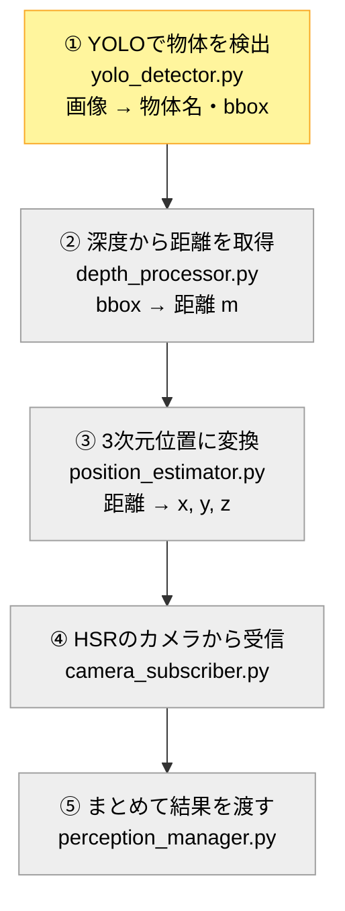
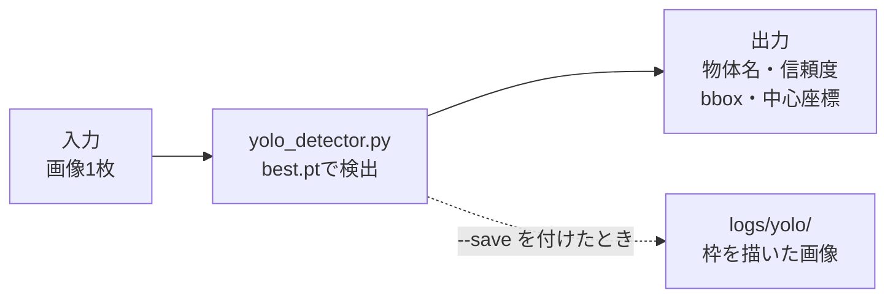
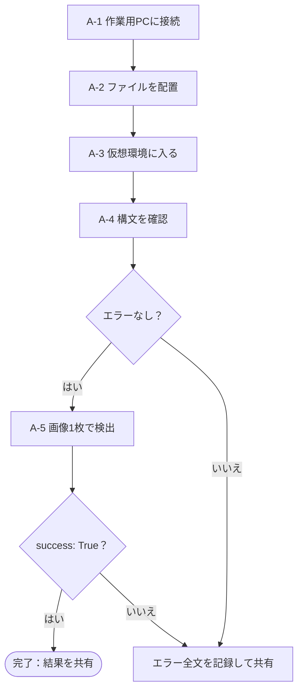
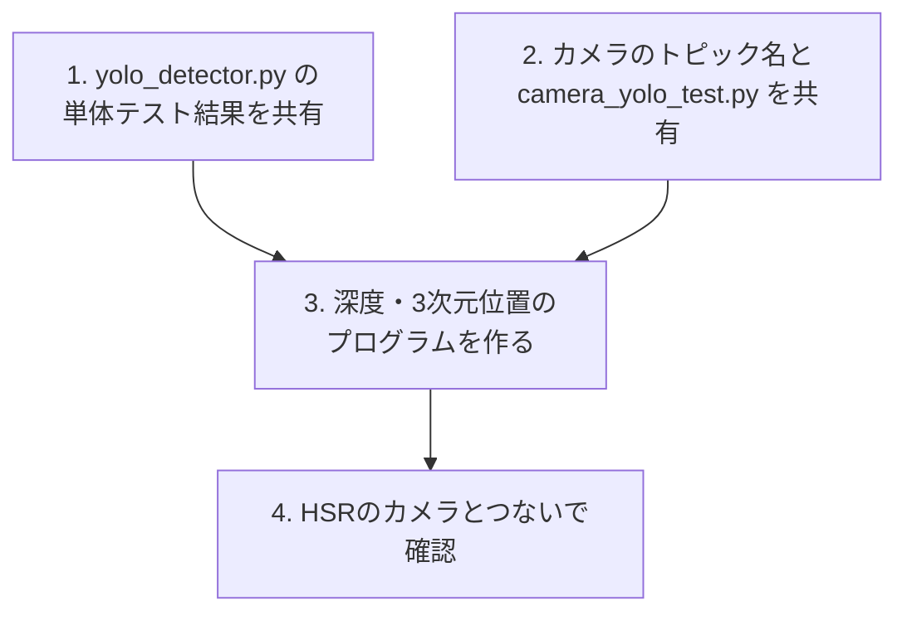

# 作業ログ：物体検出（YOLO）の再開

作業日：`2026-11-10`
作業環境：研究室PC `roboworks-shu-n` から作業用PC `katana-2024-3`（Ubuntu 24.04 ／ RTX 4070 Laptop）にSSHで接続 ／ 仮想環境 `.venv-yolo`（torch 2.15.0+cu132、ultralytics 8.4.202）／ モデル `models/best.pt`（yolov8n、7クラス）／ HSRへは `katana-2024-3` からROSで接続

## 目次

1. [この資料の読み方](#how-to-read)
2. [用語の説明](#glossary)
3. [全体の進み具合（ひと目で分かる図）](#overview)
4. [Done：終わったこと](#done)
5. [Doing：途中のこと](#doing)
   - [手順A：物体検出を画像1枚でテストする](#doing-yolo-test)
   - [カメラ連携](#doing-camera)
6. [Next：次にやること](#next)
7. [Todoリスト](#todo)
8. [注意点](#cautions)

---

<a id="how-to-read"></a>
## 1. この資料の読み方

この資料は「Done / Doing / Next」の3つに分けて書いている。

| 区分 | 意味 | 読むとよい人 |
| --- | --- | --- |
| **Done** | もう終わったこと・決まったこと | 今までの流れを知りたい人 |
| **Doing** | 途中で止まっていること（手順つき） | 続きの作業をする人 |
| **Next** | これからやること | 次の予定を知りたい人 |

- コマンドは `このような枠` に書いている。ターミナルにそのままコピーして使える。
- 「期待する結果」と同じ表示になれば成功。違う表示が出たら、表示された文字をそのまま記録して共有する。
- 各セクションの最後にある [▲ 目次へ戻る](#目次) を押すと目次に戻れる。

[▲ 目次へ戻る](#目次)

---

<a id="glossary"></a>
## 2. 用語の説明

| 用語 | 説明 |
| --- | --- |
| SSH | 別のPCにネットワーク越しにログインして操作する仕組み |
| ROS | ロボットのプログラム同士をつなぐ仕組み |
| トピック | カメラ画像などのデータを送受信する通路 |
| YOLO | 画像から物体の種類と位置を検出するAIモデル |
| `best.pt` | 学習済みのYOLOモデルのファイル |
| 信頼度（confidence） | YOLOがその検出にどれくらい自信があるか（0〜1） |
| bbox（バウンディングボックス） | 検出した物体を囲む四角形 `[x1, y1, x2, y2]`（単位：ピクセル） |
| 深度画像 | カメラから物体までの距離を表す画像 |
| カメラ内部パラメータ | カメラのレンズの特性を表す数値（fx, fy, cx, cy）。画像上の位置を3次元の位置に変換するときに使う |
| 仮想環境（venv） | プロジェクト専用のPython環境。ほかの環境とライブラリが混ざらない |
| 単体テスト | ほかの機能とつなぐ前に、その機能だけで動作を確認すること |

[▲ 目次へ戻る](#目次)

---

<a id="overview"></a>
## 3. 全体の進み具合（ひと目で分かる図）

### 物体検出の流れと現在地

最終的には、カメラ画像から「何が・どこに（3次元の位置）あるか」を求めて、HSRが物体をつかめるようにする。
今は **①の単体テスト** をしているところ。



| 色 | 意味 |
| --- | --- |
| 黄色 | 作業中（Doing） |
| 灰色 | まだ（Next） |

### 作業の状況

| 作業 | 状況 |
| --- | --- |
| YOLOの学習（7クラス） | ✅ 完了 |
| 作業用PCでの推論環境の構築 | ✅ 完了 |
| `yolo_detector.py` の作成 | ✅ 完了 |
| `yolo_detector.py` の単体テスト | 🟡 作業中（未実行） |
| カメラ連携（`camera_yolo_test.py`） | 🟡 作業中 |
| 深度・3次元位置 | ⬜ これから |

[▲ 目次へ戻る](#目次)

---

<a id="done"></a>
## 4. Done：終わったこと

- 対象7クラスでYOLOを学習済み（`models/best.pt`）。
- 作業用PC `katana-2024-3` に推論環境（`.venv-yolo`）を作り、画像1枚の検出に成功している。
- `yolo_detector.py` を作成した（Claude）。

配置先：`hsr_cup_ws/src/erasers_cup_perception/scripts/yolo_detector.py`



**結果の形式**：ほかのプログラムから使いやすいように、成功・失敗が分かる形で返す。

```python
{
    "success": True,          # 検出できたか
    "data": [                 # 検出した物体（信頼度の高い順）
        {
            "class_id": 0,
            "class_name": "apple",
            "confidence": 0.91,
            "bbox": [x1, y1, x2, y2],   # ピクセル
            "center": [u, v]            # ピクセル
        }
    ],
    "error": None             # 失敗したときの理由
}
```

**オプション**

| オプション | 働き |
| --- | --- |
| `--image` | テストする画像を指定する（必須） |
| `--target apple` | 指定したクラスだけを返す |
| `--conf 0.5` | 信頼度がこの値より低い検出を捨てる |
| `--save` | 枠と中心点を描いた画像を `logs/yolo/` に保存する |

**対象クラス**

| ID | クラス名 |
| --- | --- |
| 0 | apple |
| 1 | fried_shrimp |
| 2 | spoon |
| 3 | mustard |
| 4 | strawberry |
| 5 | banana |
| 6 | spam |

[▲ 目次へ戻る](#目次)

---

<a id="doing"></a>
## 5. Doing：途中のこと

<a id="doing-yolo-test"></a>
### 手順A：物体検出を画像1枚でテストする（未実行）



#### A-1. 研究室PCから作業用PCに接続する

```bash
ssh katana-2024-3
cd ~/erasers_ws/yolo_ws/hsr_cup_ws
```

期待する結果：プロンプト（`$` の前の表示）が `katana-2024-3` になる

#### A-2. ファイルを配置する

`yolo_detector.py` を次の場所に置く。フォルダが無ければ作る。

```bash
mkdir -p src/erasers_cup_perception/scripts
ls src/erasers_cup_perception/scripts/
```

期待する結果：`yolo_detector.py` が表示される

#### A-3. 仮想環境に入る

```bash
source .venv-yolo/bin/activate
```

期待する結果：プロンプトの先頭に `(.venv-yolo)` が付く

#### A-4. 構文を確認する

構文確認は「Pythonの書き方に間違いがないか」だけを調べる。正しく動くかは次のA-5で確認する。

```bash
python3 -m py_compile src/erasers_cup_perception/scripts/yolo_detector.py
```

期待する結果：何も表示されずに終わる

#### A-5. 画像1枚で検出する

`test.jpg` の部分は、実際の画像ファイル名に合わせて変更する。

```bash
python3 src/erasers_cup_perception/scripts/yolo_detector.py \
  --image test_data/images/test.jpg --save
```

期待する結果：

```text
success: True  error: None  time: 0.xxxs
{'class_id': 0, 'class_name': 'apple', 'confidence': 0.91, 'bbox': [...], 'center': [...]}
saved: .../logs/yolo/test_result.jpg
```

（数値は例）

#### うまくいかないとき

| 表示・症状 | 原因 | 対処 |
| --- | --- | --- |
| `model not found` | `best.pt` の場所が違う | `ls models/` で `best.pt` があるか確認する |
| `画像を読み込めません` | 画像のパスが違う | `ls test_data/images/` で実際のファイル名を確認する |
| `ModuleNotFoundError: ultralytics` | 仮想環境に入っていない | A-3をやり直す |
| `success: False  error: Object not found` | 画像に対象物体が写っていない、または信頼度が低い | 別の画像で試す、`--conf 0.3` に下げて試す |

<a id="doing-camera"></a>
### カメラ連携

- `camera_yolo_test.py` に着手済み。HSRのカメラ画像をYOLOに渡すためのプログラム。
- 中身はまだClaudeに共有していない。次に bbox・中心座標と深度の対応付けを行う予定。

[▲ 目次へ戻る](#目次)

---

<a id="next"></a>
## 6. Next：次にやること



1. `yolo_detector.py` の単体テストを実行し、結果を共有する（[手順A](#doing-yolo-test)）。
2. 使うカメラのトピック名を確認し、`camera_yolo_test.py` の中身と一緒に共有する。HSRに接続している作業用PCで実行する。

   ```bash
   rostopic list | grep -E "rgb|depth|camera_info"
   ```

   HSR頭部カメラを使うのか、別に起動している xtion を使うのかを確認する。

3. 物体検出の続きを作る。

   | ファイル | やること |
   | --- | --- |
   | `depth_processor.py` | bbox中心付近の深度から距離[m]を取得する |
   | `position_estimator.py` | カメラ内部パラメータで3次元位置（カメラ座標系）に変換する |
   | `camera_subscriber.py` | HSRのカメラからRGB・深度・camera_infoを受け取る |

4. HSRのカメラとつないで、実際の映像で検出できるか確認する。

[▲ 目次へ戻る](#目次)

---

<a id="todo"></a>
## 7. Todoリスト

終わった項目は `- [ ]` を `- [x]` に書き換えてチェックを付ける。GitHub上ではチェックボックスとして表示される。

### ① 単体テスト（`yolo_detector.py`）

- [ ] 研究室PCから `katana-2024-3` にSSHで接続する
- [ ] `yolo_detector.py` を `src/erasers_cup_perception/scripts/` に配置する
- [ ] `test_data/images/` にテスト画像を置く（7クラスが写った画像を数枚）
- [ ] 仮想環境 `.venv-yolo` に入る
- [ ] 構文確認（`py_compile`）でエラーが出ないことを確認する
- [ ] 画像1枚で `success: True` が表示されることを確認する
- [ ] `logs/yolo/` に保存された画像で、枠と中心点の位置が正しいか目で確認する
- [ ] `--target` で1クラスだけ返ることを確認する
- [ ] 対象物体が写っていない画像で `success: False` になることを確認する
- [ ] 1枚あたりの処理時間（`time:`）を記録する
- [ ] テスト結果（実行したコマンド・出力・エラー）を共有する

### ② カメラの確認

- [ ] 作業用PCからHSRにROSで接続できることを確認する
- [ ] `rostopic list` でRGB・深度・camera_info のトピック名を調べる
- [ ] HSR頭部カメラと xtion のどちらを使うか決める
- [ ] 深度画像の形式（mm単位か m単位か）を `rostopic echo` などで確認する
- [ ] `camera_info` からカメラ内部パラメータ（fx, fy, cx, cy）を記録する
- [ ] `camera_yolo_test.py` の中身を共有する

### ③ 深度・3次元位置

- [ ] `depth_processor.py` を作る（bbox中心付近の深度から距離[m]を取得）
- [ ] 保存した深度画像で、実際に測った距離と比べて確認する
- [ ] `position_estimator.py` を作る（距離 → x, y, z に変換）
- [ ] 物体を置いた位置をメジャーで測り、計算結果と比べる

### ④ HSRのカメラとつなぐ

- [ ] `camera_subscriber.py` を作る（RGB・深度・camera_info を受け取る）
- [ ] HSRのカメラ映像で7クラスが検出できるか確認する
- [ ] 検出結果と3次元位置を `perception_manager.py` でまとめて返す

[▲ 目次へ戻る](#目次)

---

<a id="cautions"></a>
## 8. 注意点

- カメラ座標系の位置を、そのまま腕やグリッパーに渡さない。つかむ前に、TF（座標を変換するROSの仕組み）でロボット側の座標系に変換する。
- 実際のカメラ内部パラメータを設定するまでは、3次元位置の値をつかむ動作に使わない。
- 分からないことは推測で決めず、「未確認」と書いて残す。

[▲ 目次へ戻る](#目次)
