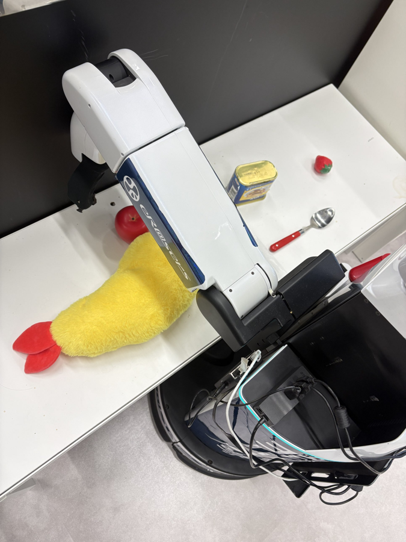

# 作業ログ 2026-11-24（D班：把持の修正 — apple の形・spoon の赤い持ち手・接触判定）

eR@sers cup 2026 ／ 本番 2026-12-03 ／ 各班コード期限 11/27 ／ 全体確認 12/2
場所：katana-2024-3 ／ HSR `192.168.11.80` ／ 課題：Fetch & Handover（7分・物体7種）

## 1. 今日の結果（先に結論）

| 項目 | 状態 |
|---|---|
| apple の形の確認（候補2） | 完了（指が閉じる方向の幅が 0.112〜0.172 m。実物 約 0.075 m より大きい） |
| `whole_body.linear_weight` が使えるか | 完了（`3.0`、`angular_weight` は `1.0`） |
| 台車の出方の測定（`tf_echo odom base_footprint` の前後） | 調査中（「前」の1回分のみ） |
| apple の奥をつかみに行く問題（`measure_shape`） | 動作を確認（ユーザーの報告、11:04） |
| spoon の把持（赤い持ち手・平たい物の指先の高さ） | 動作を確認（11:04 と 12:14 で把持に成功） |
| つかむあいだ `linear_weight` を 10 に | 調査中（台車の出方は未測定） |
| 触れた判定ははさむ前の最後の 2 cm だけ（`approach_with_touch`） | 動作を確認（spoon・strawberry のログで最後の 2 cm を 5 mm ずつ進む） |
| つかめたかの判定を腕をたたんだあとに移す | 動作を確認（spoon・strawberry とも `結果: 成功`） |
| 全物体の単体の把持（`grasp.py`） | 動作を確認（ユーザーの報告で全物体成功） |
| 通し実行（`fetch_test.py`、移動 → 把持 → 戻る → 手渡し） | 未実行 |
| 変更したコードの commit・push | 未実行（katana から push する） |

## 2. 作業手順

### 前回の「次にやること」の確認
1. spoon で `grasp.py --approach-only` を実行した
   - 結果: `上（方向 +0 度、手首 0 度、点群で測った形）` だけ ○。斜め上は「指が閉じる方向の幅がハンドに入らない」か「テーブルを避けると指先が物体に届かない」。手を出した直後に `Got a transition callback on a goal handle that we're not tracking` のエラー。ログに `--approach-only: 物体の手前で止めました` の行はない
   - 数値: base_link x=0.653 y=-0.139 z=0.397。幅 0.167 / 0.166 / 0.143 m、届かない量 0.052 / 0.052 / 0.050 m。手の目標 x=2.630 y=-1.730 z=0.564（odom）
2. apple で `grasp.py --approach-only` を実行した
   - 結果: `上` だけ ○ で、ほかは「指が閉じる方向の幅がハンドに入らない」。`--approach-only: 物体の手前で止めました`、`結果: 失敗`
   - 数値: base_link x=0.832 y=0.151 z=0.469。幅 0.112 / 0.164 / 0.155 / 0.172 / 0.122 / 0.168 / 0.112 / 0.155 / 0.122 m。手の目標 x=2.907 y=-2.016 z=0.595（odom）
3. `rosrun tf tf_echo odom base_footprint` で台車の位置を読んだ
   - 結果: 1回分だけ読めた。`--approach-only` のあとの値は読めていない
   - 数値: Translation [0.294, 0.225, 0.000]、RPY (degree) [0.000, 0.000, -62.281]
4. ihsrb で台車の重みを確認した
   - 数値: `whole_body.linear_weight` = 3.0、`whole_body.angular_weight` = 1.0
5. 方針を決めた
   - 結果: spoon は赤い持ち手を検出してつかむ。テーブルに触れたときの動きを入れる（このあと仕様を変更）

### apple の奥をつかみに行く問題
1. `object_position_node.py` に `connected_part` を追加し、`measure_shape` で使うようにした
   - 結果: 上から見て、見えている面の点とつながっている点だけを物体の点として残す
   - 数値: `GRID_SIZE` 0.01 m（約 2 cm 以上離れた点は別の物）。壁を置いた模擬データで、幅 0.159 → 0.042 m、中心 0.879 → 0.837 m（実際 0.85）

### spoon の赤い持ち手
1. `object_position_node.py` に `measure_grip` を追加した
   - 結果: spoon の枠の中で赤い画素の点を取り出し、いちばん大きいまとまりを持ち手として `"grip"` で `/ercup/detected_objects` に出す。画像に緑の十字を描く
   - 数値: `GRIP_OBJECTS = ("spoon",)`、赤は色相 10 以下または 170 以上、`RED_SAT_MIN` 120、`RED_VAL_MIN` 60、テーブルより 0.004〜0.05 m の点
2. `grasp_planner.py` で `"grip"` があれば持ち手の形を使い、上からつかむようにした
3. `grasp_planner.py` で、平たい物を上からつかむ指先を `table_z + FLAT_FINGERTIP_ABOVE_TABLE` にした
   - 理由: `max()` の中で `height / 2` に負けていた（11/21 の候補1）

### テーブルに触れたときの動き
1. 手首の力センサで触れたら動きを変える処理を入れた
   - 結果: 平たい物は 5 mm ずつ下ろし 3 N で触れたら 7 mm 上げてはさむ（`touch_down`）。それ以外は 8 N で当たったら 3 cm 上げて次の挑戦
2. 上の処理を外した
   - 理由: spoon は把持に成功したが、そのあとにテーブルに触れたときの動きを実行してしまった
3. 単体テストでも、再挑戦の前に `kitchen/table` へ戻るようにした
   - 結果: `--retry-location` を追加（既定 `kitchen/table`、`""` でその場で再挑戦）
4. 触れた判定を、はさむ前の最後の 2 cm だけで行うようにした（`approach_with_touch`）
   - 結果: はさむ位置の 2 cm 手前までは普通に進め、そこから 5 mm ずつ進めて力を見る。触れたら 5 mm 戻してはさむ。力センサが届かなければ確かめずに進める
   - 数値: `TOUCH_ZONE` 0.02 m、`TOUCH_STEP` 0.005 m、`TOUCH_FORCE` 8.0 N、`TOUCH_BACK` 0.005 m、`WRIST_TOPIC` `/hsrb/wrist_wrench/compensated`

### つかめたかの判定のタイミング
1. はさんだ直後の判定をやめ、持ち上げてから判定するようにした
   - 理由: 机にあたって spoon を把持したあと、アームを上げる手前でハンドを開いてしまっていた
2. 判定を、腕をたたんで `move_to_go` の姿勢に戻ったあとの1回だけにした
   - 結果: それまではハンドを閉じたまま。空なら `escape()` でハンドを開き、`kitchen/table` に戻って再挑戦
   - 数値: 0.3 秒待ってから指の間隔で判定
3. spoon と strawberry で `grasp.py` を実行した
   - 結果: どちらも `結果: 成功`。ほかの物体もすべて成功（ユーザーの報告）
   - 数値: spoon 力の変化 2.3 N、指の間隔 0.002 m（0.001 m 以下なら空振り）、残り 46 秒。strawberry 力の変化 0.0 N、指の間隔 0.032 m（0.003 m 以下なら空振り）、残り 84 秒

### 台車を前に出にくくする
1. `grasp()` のあいだだけ `whole_body.linear_weight` を 10（標準 3.0）にし、終わったら元に戻すようにした

**変更したファイル**
- `object_position_node.py`: `connected_part` で見えている面とつながった点だけを使う、`measure_grip` で spoon の赤い持ち手を `"grip"` として出す
- `grasp_planner.py`: `"grip"` があれば持ち手を上からつかむ、平たい物の指先の高さを修正、候補に `table_z` と `flat` を追加
- `grasp.py`: `approach_with_touch`（最後の 2 cm だけ触れた判定）、つかめたかの判定を `move_to_go` のあとに移動、`linear_weight` を 10 に、単体テストに `--retry-location`

## 3. 考察

- 確認できたこと
  - 候補2（apple）は当たり。`measure_shape` が奥の点も物体の点として数えていた
    - 根拠：apple の幅 0.112〜0.172 m（実物 約 0.075 m）。apple の z=0.469 は、テーブル 0.400 ＋ 半径 0.0375 ≒ 0.44 より高い。写真でハンドが apple の奥側にある
  - `connected_part` を含む 10:26 の変更のあと、apple がつかめるようになった
    - 根拠：ユーザーの報告「appleは成功しました」（11:04）
  - 台車の出方は、今日の材料では分からない
    - 根拠：`tf_echo` の値は1回分だけ。台車 (0.294, 0.225) と手の目標 x=2.630 y=-1.730 が 3 m 近く離れている
  - spoon の指の間隔は、空振りの基準との差が 1 mm しかない
    - 根拠：指の間隔 0.002 m、基準 0.001 m
  - 把持のあとの残り時間は、spoon が strawberry より短い
    - 根拠：残り時間 spoon 46 秒、strawberry 84 秒
  - 最後の 2 cm の接触判定は、spoon・strawberry では反応しなかった
    - 根拠：力の変化 2.3 N（spoon）、0.0 N（strawberry）。しきい値 8.0 N

## 4. 次にやること

- [ ] 6物体 × 3回の通し確認（`fetch_test.py`。合格：`手渡し: 成功` が3回中2回）
- [ ] 通しで spoon が「空」と判定されたら、`grasp_config.py` の spoon の `min_gap` を 0.0005 にする
- [ ] `WRIST_TOPIC` が `handover.py` の力センサのトピックと同じか確認
- [ ] `TOUCH_FORCE` などの仮の値を確かめる
- [ ] `--approach-only` の前後で `rosrun tf tf_echo odom base_footprint` を読み、台車がどれだけ前に出るかを spoon と apple で測る（`linear_weight` 10 の効果の確認）
- [ ] 再挑戦で、1回目の ○ をもう一度試すかどうかを決める（`order_by_untried`）
- [ ] apple 2回目で通信が止まった件（11/21）：そのとき非常停止を押したかを確認
- [ ] 今日の変更（`grasp.py`・`grasp_planner.py`・`object_position_node.py`）、`fetch_test.py` の再挑戦で戻る変更、`go_to_location.py` の新しい座標を commit・push（11/27 まで。座標は③班と共有）
- [ ] 統合担当に、`grasp()` で戻るには `omni_base` と `retry_location` を渡す必要があることを伝える
- [ ] 手順書に「手渡し」の章を足す（11/19 から持ち越し）
